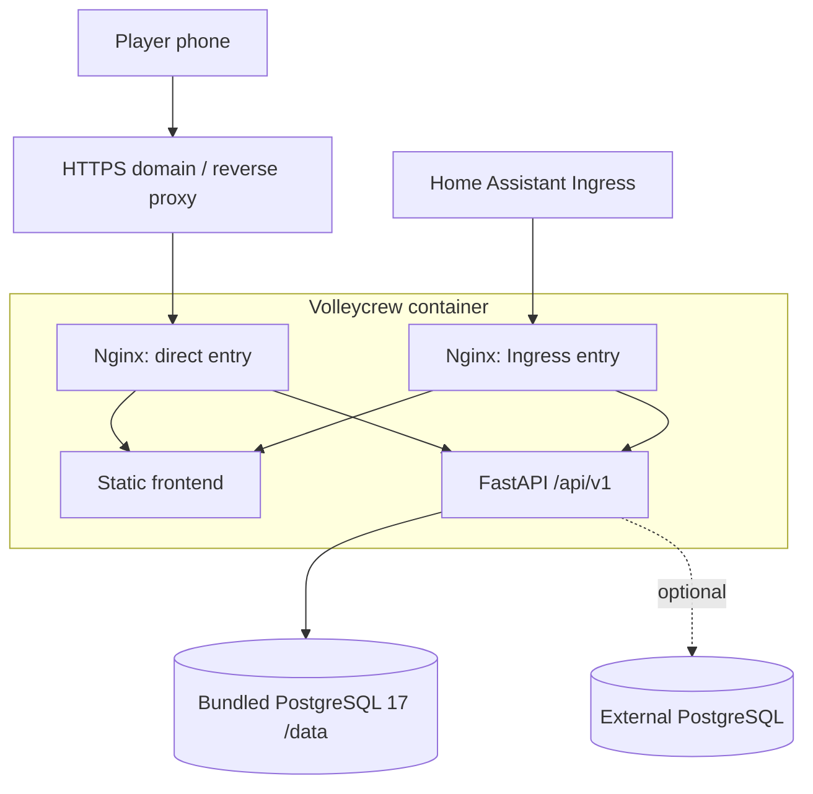

# Architecture and startup

## Technical foundation

| Area       | Selection in the plan                                        | Reason                                                                          |
| ---------- | ------------------------------------------------------------ | ------------------------------------------------------------------------------- |
| Frontend   | React, TypeScript, Vite, React Router                        | Interactive mobile application; static build without Node process in production |
| UI         | CSS with project A tokens; accessible form/dialog components | Preserving the approved appearance without copying the minified prototype       |
| Data in UI | TanStack Query; local form status                            | Single handling of downloads, data invalidation and errors                      |
| API        | Python, FastAPI, Pydantic                                    | Consistent with the maybe-finance backend                                       |
| Database   | PostgreSQL, SQLAlchemy, Alembic                              | Enrollment transactions, history and migrations                                 |
| Serving    | Nginx + Uvicorn in one container, s6                         | One installable HA application                                                  |
| Tests      | pytest, test PostgreSQL, Vitest, Playwright                  | Domain rules, integration and real user paths                                   |

The selection of supported versions and their pinning in the lockfile is E0/E1. Without Redis, Celery, microservices and a separate frontend rendering server in the first version. Single backend process to start; correctness is based on the database, not on the process memory.

## Flow



Package implementation status and acceptance testing limits: [report E10](e10-report.md); [installation instructions](../../volleycrew/DOCS.md). The user publishes/adds the repository and installs the application himself.

Home Assistant is the application host, not the player's identity provider. Both entrances use Volleycrew authorization; the HA admin account does not grant the application admin role.

## Target structure

```text
repository.yaml                  # HA app repository
volleycrew/
  config.yaml                    # HA manifest, options, version, architectures
  Dockerfile
  rootfs/                        # Nginx configuration, init and s6 services
  backend/
    pyproject.toml
    app/
      api/                       # HTTP, authorization, DTOs; thin endpoints
      core/                      # configuration, DB, sessions, clock
      models/                    # SQLAlchemy models
      services/                  # auth, schedules, enrollment, attendance, games, rating, documents
    migrations/
    tests/
  frontend/
    src/
      app/                       # router, layout, providers
      features/                  # auth, meetings, calendar, ranking, profile, admin
      components/                # shared components and court
      lib/                       # API client, formatting, contracts
    e2e/
compose.dev.yaml                 # local test/development database
docs/implementation/
prototype/                       # approved UI reference
```

Do not transfer fictitious data to production migrations. Demo data belongs only in an explicit development seed.

## Module and contract boundaries

The API runs through domain services that control transactions. Services do not depend on React, HA headers or HTTP rendering. ELO calculations are a pure function, while the ranking recording belongs to the transactional results service.

The backend OpenAPI is the source of the HTTP contract; frontend uses generated types. The description in `domain-api.md` determines the meaning of the endpoints. Changing the DTO requires updating contracts and consumers in one task.

Configuration from validated environment settings; in HA init reads `/data/options.json`. Pass values as s6 environment files, without `eval`. Do not write passwords, PINs, tokens or the full connection string in the logs.

## Home Assistant startup model

Pattern read from `../maybe-finance`: main `repository.yaml`, application folder from `config.yaml`, multi-stage Dockerfile, s6, Nginx, API pre-boot migrations and separate PostgreSQL. Do not copy without analyzing Next.js, banking integrations or `host_network: true`.

- One Volleycrew app, independent of maybe-finance. Separate slug, port, database and database user. The user chose a separate PostgreSQL server - without sharing the maybe-finance server. Environment details: [E0 findings](e0-foundations.md).
- Target architectures `amd64` and `aarch64`; both require image verification.
- Container network; the backend only listens inside the container. Only Nginx is available from the outside.
- The application does not need API or Home Assistant configuration files. Permissions and mappings limited to application needs.
- Ingress input allows only trusted Supervisor traffic. Direct input is a separate listener; this excludes accidentally opening the Ingress listener to public clients. Ports are determined by E0.
- Ingress path prefix support includes assets, APIs, routing, redirects and cookies. Test dynamic prefix; `ingress: true` alone in the manifest does not prove application compatibility.
- Frontend and API have a common origin; no public wide CORS. Proxy headers accepted only from trusted addresses. HTTPS ends with the established proxy; do not trust any `X-Forwarded-Proto`.
- Persistent files and possible instance secrets in `/data`. PDF can be generated on demand, without a permanent archive.
- Bootstrap creates Arkadiusz as an administrator in a one-time procedure. Bootstrap shutdown results from the persistent DB state, not from a container restart.
- Initialization: configuration validation → waiting for database with limit → migrations → API. A migration error blocks the API start and gives a readable log.
- Liveness distinguishes a running process from readiness with access to the DB and the current schema. Restart cannot repair data by deleting it.

## Updates and recovery

Approved 2026-11-06 (D10): same mechanism as in maybe-finance - the user adds the repository to the Home Assistant app store, and the Supervisor builds the application locally from Dockerfile during installation/update. The application manifest does not contain the `image` field pointing to the finished Volleycrew image. `build.yaml` provides base images for architectures; downloading them from GHCR does not mean publishing your own application to GHCR. Dockerfile builds the frontend and installs the backend in multiple steps, and S6 starts the services. Manual update after raising `version` in `config.yaml` and refreshing the store. Do not add a pipeline publishing the finished image as a condition for installation. The manifest version corresponds to the code release; changing a tag without a new version is not an update procedure.

The build happens during installation/update, not every time you run it. We retain the Volleycrew architecture with a static frontend; Deployment compatibility does not require copying Next.js, Node runtime, or maybe-finance port number. In E10, measure RAM consumption and local build time on the target Raspberry Pi 4.

Before updating: backup database and configuration, then migration. Application HA backup does not replace the external PostgreSQL copy. Establish a copy outside the host and check the restore on an empty database. Image rollback is only allowed with a compatible schema; otherwise, recreate a compatible image set and database. When restoring, take into account session keys and the need to log in again.

## Environments

Development, test and production have different databases, secrets and URLs. The tests do not use maybe-finance data. Locally, the frontend works with Vite, API with Uvicorn, database via Compose. The production build is also run outside HA for container testing. Commands should be defined in E1 and documented in the main README.

## Technical sources

- Local reference: `../maybe-finance/repository.yaml`, `maybe-finance/{config.yaml,build.yaml,Dockerfile}`, `rootfs/etc/{cont-init.d,services.d,nginx}`. Status read 2026-11-06; Volleycrew's deployment source will be its own configuration.
- [HA - Application Configuration](https://contributors.home-assistant.io/apps/reference/configuration/).
- [HA - Ingress](https://contributors.home-assistant.io/apps/guides/ingress/).
- [Vite - static deployment](https://vite.dev/guide/static-deploy).
- [FastAPI - Containers](https://fastapi.tiangolo.com/deployment/docker/).

Before implementing the configuration, re-verify the current HA and base image instructions. Don't pin versions based solely on the old maybe-finance Dockerfile.

## Clarifications E10

Inputs use separate cookie names and paths. Nginx renders the HTML base path and passes the trusted prefix to the backend; the frontend uses it in the router and API. The HA address is added as HTTPS origin, without authorization by the HA role. The first administrator can be created with BOOTSTRAP_TOKEN in options, without SSH; the token is not an HA or GitHub API token.

`build.yaml` remains for compliance with the agreed deployment method. Current HA documentation marks it as deprecated but supported; Dockerfile also has a default multiarch image pinned and does not rely on passing BUILD_FROM. The base image/s6 change must be verified together with the supporting scripts.

Copies in /data are local; backup_pre creates a fresh dump of the external DB before the HA copy. The encrypted HA target outside the host and the recovery test from there are configured by the user. The Restore operator has an explicit separate empty target URL and invalidates sessions by default. Details and limitations of physical tests are in the E10 report.

## Bundled PostgreSQL - 0.2.0

User Decision 2026-11-08 replaces the requirement for a separate server for new installations. Private PostgreSQL starts before migrations, then runs as a supervised S6 service. The database and the role without a superuser are created automatically, the password is random and permanent. Listener loopback only, no mapping 5432. AUTO preserves existing external host; the persisted mode does not change without migration. HA backup stops the application and saves a consistent cluster. Additional logical copies are portable; if cluster files are missing, controlled recovery uses the recovery archive.
