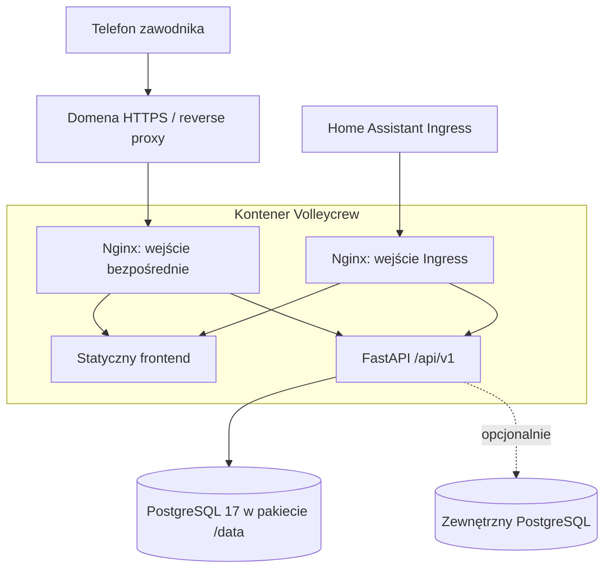

# Architektura i uruchamianie

## Baza techniczna

| Obszar | Wybór w planie | Powód |
| --- | --- | --- |
| Frontend | React, TypeScript, Vite, React Router | Interaktywna aplikacja mobilna; statyczny build bez procesu Node w produkcji |
| UI | CSS z tokenami projektu A; dostępne komponenty formularzy/dialogów | Zachowanie zaakceptowanego wyglądu bez kopiowania minifikowanego prototypu |
| Dane w UI | TanStack Query; lokalny stan formularzy | Jedna obsługa pobierania, unieważniania danych i błędów |
| API | Python, FastAPI, Pydantic | Zbliżenie do backendu maybe-finance |
| Baza | PostgreSQL, SQLAlchemy, Alembic | Transakcje zapisów, historia i migracje |
| Serwowanie | Nginx + Uvicorn w jednym kontenerze, s6 | Jedna instalowalna aplikacja HA |
| Testy | pytest, testowa PostgreSQL, Vitest, Playwright | Reguły domeny, integracja i rzeczywiste ścieżki użytkownika |

Dobór wspieranych wersji i ich przypięcie w lockfile to E0/E1. Bez Redis, Celery, mikroserwisów i osobnego serwera renderowania frontendu w pierwszej wersji. Proces backendu pojedynczy na start; poprawność opiera się na bazie, nie na pamięci procesu.

## Przepływ



Stan implementacji pakietu i granice odbioru: [raport E10](e10-report.md); [instrukcja instalacji](../../volleycrew/DOCS.md). Użytkownik samodzielnie publikuje/dodaje repozytorium i instaluje aplikację.

Home Assistant jest gospodarzem aplikacji, nie dostawcą tożsamości zawodników. Oba wejścia korzystają z autoryzacji Volleycrew; konto administratora HA nie nadaje roli administratora aplikacji.

## Struktura docelowa

```text
repository.yaml                  # repozytorium aplikacji HA
volleycrew/
  config.yaml                    # manifest HA, opcje, wersja, architektury
  Dockerfile
  rootfs/                        # konfiguracja Nginx, init i usługi s6
  backend/
    pyproject.toml
    app/
      api/                       # HTTP, autoryzacja, DTO; cienkie endpointy
      core/                      # konfiguracja, DB, sesje, zegar
      models/                    # modele SQLAlchemy
      services/                  # auth, schedules, enrollment, attendance, games, rating, documents
    migrations/
    tests/
  frontend/
    src/
      app/                       # router, layout, providery
      features/                  # auth, meetings, calendar, ranking, profile, admin
      components/                # współdzielone elementy i boisko
      lib/                       # klient API, formatowanie, kontrakty
    e2e/
compose.dev.yaml                 # lokalna testowa/deweloperska baza
docs/implementation/
prototype/                       # referencja zaakceptowanego UI
```

Nie przenosić fikcyjnych danych do produkcyjnych migracji. Dane demo wyłącznie w jawnym seedzie środowiska developerskiego.

## Granice modułów i kontrakt

API prowadzi przez serwisy domenowe, które kontrolują transakcje. Serwisy nie zależą od Reacta, nagłówków HA ani renderowania HTTP. Obliczenia ELO są czystą funkcją, natomiast zapis rankingu należy do transakcyjnego serwisu wyników.

OpenAPI backendu jest źródłem kontraktu HTTP; frontend używa wygenerowanych typów. Opis w `domain-api.md` ustala znaczenie endpointów. Zmiana DTO wymaga aktualizacji kontraktu i konsumentów w jednym zadaniu.

Konfiguracja z walidowanych ustawień środowiskowych; w HA init odczytuje `/data/options.json`. Przekazuj wartości jako pliki środowiskowe s6, bez `eval`. Nie wypisuj haseł, PIN-ów, tokenów ani pełnego connection stringa do logów.

## Model uruchamiania Home Assistant

Wzorzec odczytany z `../maybe-finance`: główne `repository.yaml`, folder aplikacji z `config.yaml`, wieloetapowy Dockerfile, s6, Nginx, migracje przed startem API i osobny PostgreSQL. Nie kopiować bez analizy Next.js, bankowych integracji ani `host_network: true`.

- Jedna aplikacja Volleycrew, niezależna od maybe-finance. Osobny slug, port i baza/użytkownik DB. Użytkownik wybrał osobny serwer PostgreSQL — bez współdzielenia serwera maybe-finance. Szczegóły środowiska: [ustalenia E0](e0-foundations.md).
- Docelowe architektury `amd64` i `aarch64`; obie wymagają weryfikacji obrazów.
- Sieć kontenerowa; backend słucha tylko wewnątrz kontenera. Z zewnątrz dostępny tylko Nginx.
- Aplikacja nie potrzebuje API ani plików konfiguracji Home Assistant. Uprawnienia i mapowania ograniczone do potrzeb aplikacji.
- Wejście Ingress dopuszcza wyłącznie zaufany ruch Supervisor. Wejście bezpośrednie jest oddzielnym listenerem; wyklucza to przypadkowe otwarcie listenera Ingress dla publicznych klientów. Porty ustala E0.
- Obsługa prefiksu ścieżki Ingress obejmuje assety, API, routing, przekierowania i cookies. Testuj dynamiczny prefiks; samo `ingress: true` w manifeście nie dowodzi zgodności aplikacji.
- Frontend i API mają wspólne origin; brak publicznego szerokiego CORS. Nagłówki proxy akceptowane tylko od zaufanych adresów. HTTPS kończy się na ustalonym proxy; nie ufać dowolnemu `X-Forwarded-Proto`.
- Trwałe pliki i ewentualne sekrety instancji w `/data`. PDF może być generowany na żądanie, bez stałego archiwum.
- Bootstrap tworzy Arkadiusza jako administratora jednorazową procedurą. Zamknięcie bootstrapu wynika z trwałego stanu DB, a nie z restartu kontenera.
- Inicjalizacja: walidacja konfiguracji → oczekiwanie na bazę z limitem → migracje → API. Błąd migracji blokuje start API i daje czytelny log.
- Liveness odróżnia działający proces od readiness z dostępem do DB i aktualnym schematem. Restart nie może naprawiać danych przez ich usunięcie.

## Aktualizacje i odzyskiwanie

Zatwierdzone 2026-11-06 (D10): taki sam mechanizm jak w maybe-finance — użytkownik dodaje repozytorium do sklepu aplikacji Home Assistant, a Supervisor buduje aplikację lokalnie z Dockerfile przy instalacji/aktualizacji. Manifest aplikacji nie zawiera pola `image` wskazującego gotowy obraz Volleycrew. `build.yaml` dostarcza obrazy bazowe dla architektur; ich pobieranie z GHCR nie oznacza publikowania własnej aplikacji do GHCR. Dockerfile wieloetapowo buduje frontend i instaluje backend, a s6 uruchamia usługi. Aktualizacja ręczna po podniesieniu `version` w `config.yaml` i odświeżeniu sklepu. Nie dodawać pipeline publikującego gotowy obraz jako warunku instalacji. Wersja manifestu odpowiada wydaniu kodu; zmiana tagu bez nowej wersji nie jest procedurą aktualizacji.

Budowanie zachodzi podczas instalacji/aktualizacji, a nie przy każdym uruchomieniu. Zachowujemy architekturę Volleycrew ze statycznym frontendem; zgodność sposobu wdrażania nie wymaga kopiowania Next.js, procesu Node runtime ani numeru portu maybe-finance. W E10 zmierzyć zużycie RAM i czas lokalnego builda na docelowym Raspberry Pi 4.

Przed aktualizacją: backup bazy oraz konfiguracji, potem migracja. Backup HA aplikacji nie zastępuje kopii zewnętrznej PostgreSQL. Ustal kopię poza hostem i sprawdź odtworzenie na pustej bazie. Cofnięcie obrazu jest dopuszczalne tylko przy zgodnym schemacie; w przeciwnym razie odtwórz zgodny zestaw obrazu i bazy. Przy odtwarzaniu uwzględnij klucze sesji i konieczność ponownego logowania.

## Środowiska

Development, test i produkcja mają różne bazy, sekrety i URL. Testy nie używają danych maybe-finance. Lokalnie frontend działa z Vite, API z Uvicorn, baza przez Compose. Produkcyjny build jest również uruchamialny poza HA do testów kontenera. Komendy należy zdefiniować w E1 i udokumentować w głównym README.

## Źródła techniczne

- Referencja lokalna: `../maybe-finance/repository.yaml`, `maybe-finance/{config.yaml,build.yaml,Dockerfile}`, `rootfs/etc/{cont-init.d,services.d,nginx}`. Stan odczytany 2026-11-06; źródłem wdrożenia Volleycrew będzie jego własna konfiguracja.
- [HA — konfiguracja aplikacji](https://contributors.home-assistant.io/apps/reference/configuration/).
- [HA — Ingress](https://contributors.home-assistant.io/apps/guides/ingress/).
- [Vite — statyczne wdrożenie](https://vite.dev/guide/static-deploy).
- [FastAPI — kontenery](https://fastapi.tiangolo.com/deployment/docker/).

Przed implementacją konfiguracji ponownie zweryfikuj aktualne instrukcje HA oraz obrazu bazowego. Nie przypinaj wersji wyłącznie na podstawie starego Dockerfile maybe-finance.


## Doprecyzowania E10

Wejścia używają oddzielnych nazw i ścieżek cookies. Nginx renderuje bazę HTML i przekazuje zaufany prefiks do backendu; frontend wykorzystuje go w routerze i API. Adres HA dodaje się jako origin HTTPS, bez autoryzacji rolą HA. Pierwszego administratora można utworzyć z BOOTSTRAP_TOKEN w opcjach, bez SSH; token nie jest tokenem API HA ani GitHub.

`build.yaml` pozostaje dla zgodności z uzgodnionym sposobem wdrożenia. Aktualna dokumentacja HA oznacza go jako przestarzały, ale wspierany; Dockerfile ma także domyślny przypięty obraz multiarch i nie polega na przekazaniu BUILD_FROM. Zmianę bazy/s6 trzeba weryfikować razem ze skryptami pomocniczymi.

Kopie w /data są lokalne; backup_pre wykonuje świeży zrzut zewnętrznej DB przed kopią HA. Szyfrowany cel HA poza hostem i test odtworzenia z tego miejsca konfiguruje użytkownik. Restore operatora ma jawny osobny URL pustego celu i domyślnie unieważnia sesje. Szczegóły oraz ograniczenia testów fizycznych są w raporcie E10.

## Własny PostgreSQL — 0.2.0

Decyzja użytkownika 2026-11-08 zastępuje wymóg osobnego serwera dla nowych instalacji. Prywatny PostgreSQL startuje przed migracjami, następnie działa jako nadzorowana usługa s6. Baza i rola bez superusera powstają automatycznie, hasło jest losowe i trwałe. Listener tylko loopback, bez mapowania 5432. AUTO zachowuje istniejący host zewnętrzny; utrwalony tryb nie zmienia się bez migracji. Backup HA zatrzymuje aplikację i zapisuje spójny klaster. Dodatkowe kopie logiczne są przenośne; przy braku plików klastra kontrolowane odtworzenie używa archiwum odzyskiwania.
